# Catálogo Mestre de Bugs, Previews Visuais e Plano de Resolução (`LumenLite / new-holyrics`)

Este documento consolida, classifica e enriquece todos os bugs e melhorias anotados durante os testes manuais do projeto, associando cada item a **arquivos e linhas exatas do código-fonte**, **causa-raiz técnica**, **previews das capturas de tela em [bugs/media/](file:///home/miguelsb/workspace/holyrics-analysis/bugs/media)** e **plano de correção**.

> **Pasta Única de Imagens:** [bugs/media/](file:///home/miguelsb/workspace/holyrics-analysis/bugs/media) (13 imagens: 12 capturas + 1 gabarito original)
> **Checklist de Execução:** [checklist.md](file:///home/miguelsb/workspace/holyrics-analysis/bugs/checklist.md)

---

## Sumário Executivo & Classificação

| Categoria | Qtd | Crítico | Alto | Médio | Melhoria / UX | Fase Alvo |
| :--- | :---: | :---: | :---: | :---: | :---: | :---: |
| **1. Layout Principal, Navegação & Command Palette** | 5 | — | 2 | 1 | 2 | Fases 1 e 2 |
| **2. Roteiro de Culto, Mídias & Drag-and-Drop** | 3 | — | 2 | 1 | — | Fase 2 |
| **3. Acervo Musical, Editor com Preview & Busca Web** | 3 | — | 1 | 1 | 1 | Fases 1 e 3 |
| **4. Apresentações PDF & PowerPoint** | 3 | 2 | 1 | — | — | Fase 4 |
| **5. Palco, Alertas Lower Thirds & Púlpito** | 3 | — | 1 | 2 | — | Fase 1 |
| **6. Controle Remoto Mobile** | 3 | 1 | 1 | 1 | — | Fase 5 |
| **7. Editor de Automações DAG & OBS Studio** | 1 | — | 1 | — | — | Fase 6 |
| **Total** | **21** | **3** | **9** | **6** | **3** | **6 Fases** |

### Índice Rápido de Severidade
- **Crítico (Quebra fluxo principal / segurança / projeção incorreta):** `BUG-12`, `BUG-13`, `BUG-18`
- **Alto (Funcionalidade ausente ou inoperante / bloqueio de operação):** `BUG-01`, `BUG-02`, `BUG-06`, `BUG-07`, `BUG-10`, `BUG-11`, `BUG-15`, `BUG-19`, `BUG-21`
- **Médio (Fricção de uso / falta de feedback / layout / vazamento técnico):** `BUG-04`, `BUG-08`, `BUG-09`, `BUG-14`, `BUG-16`, `BUG-17`, `BUG-20`
- **Melhoria / UX (Ergonomia de operador):** `BUG-03`, `BUG-05`

---

## Categoria 1 — Layout Principal, Navegação Global & Command Palette

### BUG-01 — Tecla `Esc` não fecha a Command Palette (`Ctrl+K`)
- **Severidade:** Alto | **Tipo:** Bug de Interação / Teclado | **Fase:** 1
- **Problema:** Ao abrir a paleta de comandos (`Ctrl+K`) e pressionar a tecla `Esc` com o cursor no campo de busca, o modal permanece aberto em vez de fechar.
- **Arquivos envolvidos:**
  - [SpotlightDialog.tsx](file:///home/miguelsb/workspace/holyrics-analysis/new-holyrics/apps/ui/src/operator/components/SpotlightDialog.tsx#L39-L95)
  - [useKeybindings.ts](file:///home/miguelsb/workspace/holyrics-analysis/new-holyrics/slices/keymap/ui/hooks/useKeybindings.ts#L48-L65)
  - [useOperatorShortcuts.ts](file:///home/miguelsb/workspace/holyrics-analysis/new-holyrics/slices/keymap/ui/hooks/useOperatorShortcuts.ts#L53-L85)
- **Causa-raiz:** Em `useKeybindings.ts#L50-L63`, ao pressionar `Escape` com foco no `<Command.Input>`, o atalho corresponde a `NAV_CLEAR`, executa `event.preventDefault()` e chama `onAction('NAV_CLEAR')`. Porém, `useOperatorShortcuts.ts#L53-L85` não possui `case 'NAV_CLEAR'`, descartando a ação, e `SpotlightDialog.tsx` não possui listener próprio de `Escape` nem fechamento ao clicar fora (backdrop).
- **Solução planejada:**
  1. Em `SpotlightDialog.tsx`, registrar listener `keydown` para `Escape` (fechando o modal via `onClose()`) e `onClick` no backdrop escuro.
  2. Em `useOperatorShortcuts.ts`, tratar `NAV_CLEAR` quando `isSpotlightOpen` for `true` chamando `onToggleSpotlight()`.

### BUG-02 — Unificar a Biblioteca de Letras na Coluna Esquerda (`unify-lyrics`)
- **Severidade:** Alto | **Tipo:** Arquitetura de UI / Layout | **Fase:** 2
- **Problema:** A biblioteca de músicas (`Biblioteca`) ocupa uma coluna inteira avulsa no console, desperdiçando espaço horizontal. As músicas deveriam ficar integradas como mais uma aba na coluna esquerda (`LiturgyScheduleColumn`) ao lado de **Roteiro**, **Imagens**, **Vídeos** e **Arquivos**, permitindo buscar e selecionar hinos diretamente por lá.
- **Arquivos envolvidos:**
  - [OperatorView.tsx](file:///home/miguelsb/workspace/holyrics-analysis/new-holyrics/apps/ui/src/operator/OperatorView.tsx#L143-L214)
  - [LiturgyScheduleColumn.tsx](file:///home/miguelsb/workspace/holyrics-analysis/new-holyrics/slices/liturgy/ui/components/LiturgyScheduleColumn.tsx#L30)
  - [SongSearchList.tsx](file:///home/miguelsb/workspace/holyrics-analysis/new-holyrics/slices/songs/ui/components/SongSearchList.tsx#L23-L115)
  - [BibleQuickLookupCard.tsx](file:///home/miguelsb/workspace/holyrics-analysis/new-holyrics/slices/bible/ui/components/BibleQuickLookupCard.tsx)
- **Causa-raiz:** Em `OperatorView.tsx#L143`, o grid principal fixa 4 colunas (`20fr 22fr 33fr 25fr`), mantendo a Coluna 2 (`Biblioteca`) isolada de `LiturgyScheduleColumn.tsx` (Coluna 1).
- **Solução planejada:**
  1. Adicionar a aba `LETRAS` (e `AUDIO`) em `LiturgyScheduleColumn.tsx` contendo o campo de busca de hino/versículo, botões `Importar` e `Histórico`, `BibleQuickLookupCard` e `SongSearchList`.
  2. Remover a Coluna 2 avulsa de `OperatorView.tsx`, migrando o layout principal para 3 colunas fluidas (`Navegador Esquerdo` | `Palco Central de Slides` | `Monitor de Saída Direito`).
- **Mídia ([10-roteiro-unify-lyrics.png](file:///home/miguelsb/workspace/holyrics-analysis/bugs/media/10-roteiro-unify-lyrics.png)):**

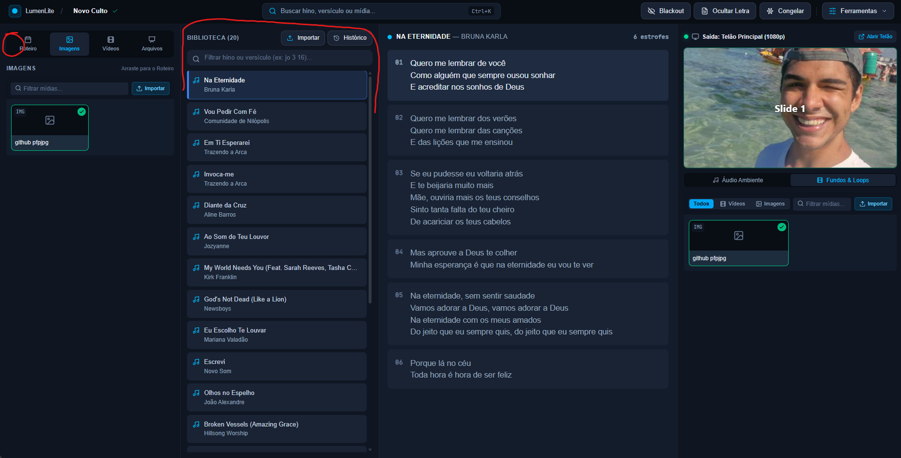

### BUG-03 — Permitir redimensionar livremente abas, colunas e seções
- **Severidade:** Melhoria / UX | **Tipo:** Layout / Ergonomia | **Fase:** 2
- **Problema:** As colunas e seções da tela do operador possuem largura e altura fixas, impedindo o operador de aumentar ou diminuir o tamanho do painel esquerdo (roteiro/mídias), do palco central ou do monitor de saída à direita conforme sua necessidade.
- **Arquivos envolvidos:**
  - [OperatorView.tsx](file:///home/miguelsb/workspace/holyrics-analysis/new-holyrics/apps/ui/src/operator/OperatorView.tsx#L143-L249)
  - [OutputMonitorPanel.tsx](file:///home/miguelsb/workspace/holyrics-analysis/new-holyrics/slices/navigation/ui/components/OutputMonitorPanel.tsx#L35-L114)
- **Causa-raiz:** As colunas usam classes CSS Grid estáticas (`lg:grid-cols-[20fr_22fr_33fr_25fr]`) sem alças de arraste (`SplitPane`) e sem persistência de largura/altura.
- **Solução planejada:** Implementar componente `ResizableSplitPane` (divisórias verticais entre colunas esquerda/centro/direita e divisória horizontal no painel de saída direito entre o monitor 16:9 e Áudio/Fundos) com persistência em `localStorage`.

### BUG-04 — Utilidade do Nome do Evento no topo e Exportação/Importação de Roteiro
- **Severidade:** Médio | **Tipo:** Funcionalidade Incompleta / UX | **Fase:** 1
- **Problema:** O campo de nome do evento na barra superior (ex.: `"Novo Culto"`) não deixa claro qual é a sua finalidade — não indica se ele representa um roteiro salvo que pode ser exportado, importado posteriormente ou alternado entre diferentes cultos.
- **Arquivos envolvidos:**
  - [OperatorTopBar.tsx](file:///home/miguelsb/workspace/holyrics-analysis/new-holyrics/slices/navigation/ui/components/OperatorTopBar.tsx#L107-L138)
  - [liturgy-router.ts](file:///home/miguelsb/workspace/holyrics-analysis/new-holyrics/slices/liturgy/daemon/routes/liturgy-router.ts#L43-L120)
  - [liturgy-repository.ts](file:///home/miguelsb/workspace/holyrics-analysis/new-holyrics/slices/liturgy/daemon/liturgy-repository.ts#L68-L100)
- **Causa-raiz:** `OperatorTopBar.tsx#L107-L138` apenas altera a propriedade `title` dentro de `culto.json` via `/api/liturgy/title`, sem expor ao operador o vínculo com o roteiro do culto nem ações de exportar, importar ou iniciar novo culto.
- **Solução planejada:** Transformar a área do nome do evento em um botão com menu de ações do roteiro: **Renomear Culto**, **Exportar Roteiro (`.json`)**, **Importar Roteiro (`.json`)** e **Novo Culto (limpar roteiro)**.
- **Mídia ([11-general-event-name.png](file:///home/miguelsb/workspace/holyrics-analysis/bugs/media/11-general-event-name.png)):**

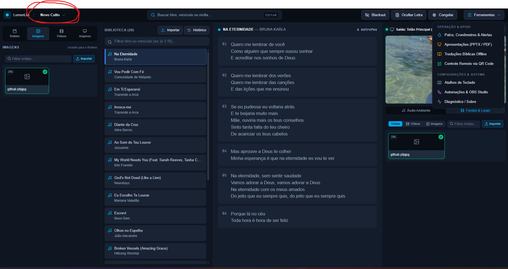

### BUG-05 — Substituir "Tempo de Pregação" por Cronômetro Progressivo de Projeção
- **Severidade:** Melhoria / UX | **Tipo:** Alinhamento com Holyrics Original | **Fase:** 1
- **Problema:** O cronômetro atual é focado em uma contagem regressiva fixa para `"Pregação"`, o que não atende ao fluxo real da cabine. O operador precisa de um cronômetro progressivo automático que exiba o tempo decorrido desde o momento em que um slide ou item começa a ser projetado no telão, assim como funciona no Holyrics original.
- **Arquivos envolvidos:**
  - [StageControlModal.tsx](file:///home/miguelsb/workspace/holyrics-analysis/new-holyrics/slices/stage/ui/components/StageControlModal.tsx#L38-L42) e [StageControlModal.tsx](file:///home/miguelsb/workspace/holyrics-analysis/new-holyrics/slices/stage/ui/components/StageControlModal.tsx#L198-L280)
  - [OutputMonitorPanel.tsx](file:///home/miguelsb/workspace/holyrics-analysis/new-holyrics/slices/navigation/ui/components/OutputMonitorPanel.tsx#L38-L64)
  - [PreacherRemoteView.tsx](file:///home/miguelsb/workspace/holyrics-analysis/new-holyrics/slices/remote/ui/components/PreacherRemoteView.tsx#L72-L93)
  - [screen-state.ts](file:///home/miguelsb/workspace/holyrics-analysis/new-holyrics/packages/core/src/fsm/screen-state.ts#L60-L68)
  - [fsm-reducer.ts](file:///home/miguelsb/workspace/holyrics-analysis/new-holyrics/packages/core/src/fsm/fsm-reducer.ts#L130-L173)
- **Causa-raiz:** `StageControlModal.tsx` fixa o rótulo padrão `"Pregação"` em contagem regressiva manual, e o estado da FSM (`ScreenState`) não registra o timestamp de início de projeção do item/slide atual.
- **Solução planejada:**
  1. Registrar `projectedAt` (início da projeção do item atual / slide) em `ScreenState` ao disparar `PRESENT_ITEM` (zerando em `CLEAR_SCREEN`).
  2. Exibir um **Cronômetro Progressivo (`MM:SS` / `HH:MM:SS`)** no cabeçalho do Monitor de Saída (`OutputMonitorPanel.tsx`) e no Palco, contando o tempo decorrido desde o início da projeção do slide/item atual.
- **Mídia ([01-disparar-alerta-overview.png](file:///home/miguelsb/workspace/holyrics-analysis/bugs/media/01-disparar-alerta-overview.png)):** veja preview completo em [BUG-15](#bug-15--bot%C3%A3o-minimal-sobreposto-pelo-campo-dura%C3%A7%C3%A3o-seg).

---

## Categoria 2 — Roteiro de Culto, Gerenciador de Mídias & Drag-and-Drop

### BUG-06 — Preview de imagens não carrega nos cards e falta visualização ampliada
- **Severidade:** Alto | **Tipo:** Bug Visual / Funcionalidade | **Fase:** 2
- **Problema:** Os cards de mídia exibem apenas um ícone genérico no lugar da miniatura real da imagem/vídeo, dificultando a identificação visual do arquivo. Além disso, falta uma opção para abrir o preview ampliado da imagem antes de projetá-la no telão.
- **Arquivos envolvidos:**
  - [MediaGridPanel.tsx](file:///home/miguelsb/workspace/holyrics-analysis/new-holyrics/slices/media/ui/components/MediaGridPanel.tsx#L233-L259)
- **Causa-raiz:** Em `MediaGridPanel.tsx#L233-L239`, embora `streamUrl` (`/api/media/stream/:id`) exista na linha 207 e funcione perfeitamente no telão, o card renderiza apenas `<Film />` ou `<ImageIcon />` no lugar de uma miniatura `` / `<video>`.
- **Solução planejada:**
  1. Renderizar `` para imagens e `<video src={streamUrl} preload="metadata" muted className="h-full w-full object-cover" />` para vídeos.
  2. Adicionar botão e opção no menu de contexto **"Visualizar Preview"** (modal Lightbox) para inspecionar a mídia em tela antes de enviá-la ao telão.
- **Mídia ([09-roteiro-image-preview-not-loading.png](file:///home/miguelsb/workspace/holyrics-analysis/bugs/media/09-roteiro-image-preview-not-loading.png)):**

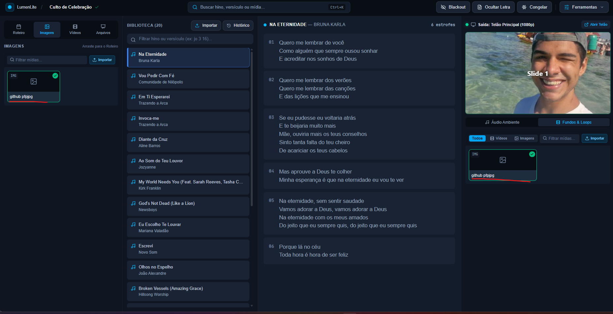

### BUG-07 — Drag & Drop universal de mídias, músicas e arquivos (do PC e entre abas) para o Roteiro
- **Severidade:** Alto | **Tipo:** Bug de Interação / DnD | **Fase:** 2
- **Problema:** Não é possível arrastar itens diretamente de outras abas (como Imagens, Vídeos, Áudio, Arquivos ou Letras) nem arrastar múltiplos formatos do computador diretamente para dentro do Roteiro quando outra aba está ativa.
- **Arquivos envolvidos:**
  - [LiturgyScheduleColumn.tsx](file:///home/miguelsb/workspace/holyrics-analysis/new-holyrics/slices/liturgy/ui/components/LiturgyScheduleColumn.tsx#L144-L263)
  - [useLiturgyController.ts](file:///home/miguelsb/workspace/holyrics-analysis/new-holyrics/slices/liturgy/ui/hooks/useLiturgyController.ts#L53-L129)
  - [MediaGridPanel.tsx](file:///home/miguelsb/workspace/holyrics-analysis/new-holyrics/slices/media/ui/components/MediaGridPanel.tsx#L211-L226)
  - [SongSearchList.tsx](file:///home/miguelsb/workspace/holyrics-analysis/new-holyrics/slices/songs/ui/components/SongSearchList.tsx#L52-L67)
- **Causa-raiz:** Quando o operador está na aba `Imagens`, `Vídeos`, `Arquivos` ou `Letras`, o container do `Roteiro` não está montado no DOM para receber o `drop`. Além disso, `handleOsFilesDropOnRoteiro` em `LiturgyScheduleColumn.tsx#L144-L179` não trata arquivos de Áudio nem permite soltar diretamente sobre o botão da aba `Roteiro`.
- **Solução planejada:**
  1. Transformar o botão da aba `Roteiro` em **drop zone ativa**: ao arrastar qualquer item interno (`application/lumen-item`) ou arquivo do SO sobre o botão `Roteiro`, destacar o botão (e alternar para a aba `Roteiro` ao segurar) e aceitar o `onDrop` diretamente nele ou na lista do roteiro.
  2. Garantir suporte a drag em todos os itens (`Letras`, `Imagens`, `Vídeos`, `Áudio`, `Arquivos`, `Fundos & Loops` na direita e arquivos do sistema operacional).

### BUG-08 — Gerenciamento de pastas/arquivos (criar, renomear, deletar, abrir local no SO) e suporte a Áudio
- **Severidade:** Médio | **Tipo:** Feature / Organização de Acervo | **Fase:** 2
- **Problema:** Faltam recursos básicos de organização nas bibliotecas de mídia e arquivos: não é possível criar pastas, renomear ou deletar arquivos/pastas em cada grupo, nem há uma opção para abrir a pasta local no explorador de arquivos do computador para adicionar arquivos em lote. Além disso, falta suporte/aba dedicada para arquivos de **Áudio** ao lado de Imagens, Vídeos e Arquivos, mantendo o Roteiro capaz de receber qualquer tipo de mídia misturado.

- **Arquivos envolvidos:**
  - [LiturgyScheduleColumn.tsx](file:///home/miguelsb/workspace/holyrics-analysis/new-holyrics/slices/liturgy/ui/components/LiturgyScheduleColumn.tsx#L30), [LiturgyScheduleColumn.tsx](file:///home/miguelsb/workspace/holyrics-analysis/new-holyrics/slices/liturgy/ui/components/LiturgyScheduleColumn.tsx#L192-L250)
  - [MediaGridPanel.tsx](file:///home/miguelsb/workspace/holyrics-analysis/new-holyrics/slices/media/ui/components/MediaGridPanel.tsx#L59-L70)
  - [media-repository.ts](file:///home/miguelsb/workspace/holyrics-analysis/new-holyrics/slices/media/daemon/media-repository.ts#L108-L253)
  - [media-router.ts](file:///home/miguelsb/workspace/holyrics-analysis/new-holyrics/slices/media/daemon/routes/media-router.ts#L140-L220)
- **Causa-raiz:** `MediaRepository` apenas varre recursivamente a pasta raiz no boot sem expor subpastas virtuais/físicas, não tem endpoints para `mkdir`, `rename` ou `open-folder` no sistema operacional, e `MediaGridPanel.tsx#L61` filtra `if (item.type === 'AUDIO') return false`.
- **Solução planejada:**
  1. Manter as abas distintas por tipo na Coluna 1 (**Roteiro | Letras | Imagens | Vídeos | Áudio | Arquivos**), garantindo que o **Roteiro** aceite qualquer tipo misturado em sequência de culto.
  2. No backend (`media-repository.ts` + `media-router.ts` + `pptx-router.ts`): implementar endpoints para **Criar Pasta**, **Renomear Arquivo/Pasta**, **Excluir**, **Reescanear Diretório** e **Abrir Pasta Local no Explorador do SO** (`xdg-open` / `explorer` / `open`).
  3. Adicionar menu de contexto (botão direito) em cada card e pasta dentro das abas de Imagens, Vídeos, Áudio e Arquivos.
- **Mídia ([08-roteiro-card-right-click.png](file:///home/miguelsb/workspace/holyrics-analysis/bugs/media/08-roteiro-card-right-click.png)):**

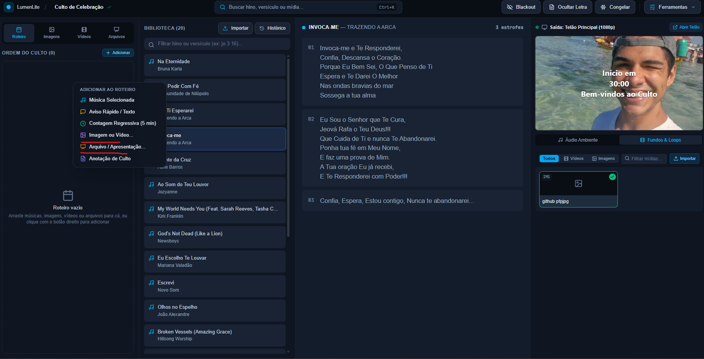

---

## Categoria 3 — Acervo Musical, Editor de Letras com Preview & Busca Online

### BUG-09 — Textos developer-centric, erro de importação exibido em verde e cache desatualizado
- **Severidade:** Médio | **Tipo:** Bug Visual / UX / Cache | **Fase:** 1 / 3
- **Problema:** O modal de importação de músicas exibe jargões técnicos voltados para desenvolvedores (como `"SQLite FTS5"`, `"fflate"` e `"tags proprietárias"`) que não fazem sentido para o operador da igreja. Além disso, quando ocorre uma falha na importação, a mensagem de erro é exibida em uma caixa verde com ícone de confirmação (`✓`), parecendo uma operação bem-sucedida, e a lista de músicas não é atualizada automaticamente após importar.
- **Arquivos envolvidos:**
  - [SongImporterModal.tsx](file:///home/miguelsb/workspace/holyrics-analysis/new-holyrics/slices/songs/ui/components/SongImporterModal.tsx#L110-L154)
  - [OperatorView.tsx](file:///home/miguelsb/workspace/holyrics-analysis/new-holyrics/apps/ui/src/operator/OperatorView.tsx#L284-L287)
- **Causa-raiz:**
  1. Strings técnicas explícitas em `SongImporterModal.tsx#L115` (`fflate`, `tags proprietárias`) e `#L145` (`SQLite FTS5`).
  2. O banner de status (`SongImporterModal.tsx#L149-L154`) sempre renderiza fundo verde (`emerald-500`) e ícone `<CheckCircle2 />`, mesmo quando ocorre erro no `catch` (`"Erro ao importar música legada."`).
  3. `OperatorView.tsx#L284-L287` renderiza `<SongImporterModal>` sem passar `onImported`, deixando de invalidar o cache `songKeys.all` do TanStack Query após salvar.
- **Solução planejada:** Substituir textos técnicos por linguagem natural do operador (ex.: *"Importar backup completo do Holyrics (.zip)"* e *"Salvar Música"*), usar estado estruturado `{ type: 'success' | 'error', text: string }` com ícone/cor vermelha (`rose`) para erros e invalidar `songKeys.all` ao concluir.
- **Mídia ([05-importar-musica-nova.png](file:///home/miguelsb/workspace/holyrics-analysis/bugs/media/05-importar-musica-nova.png)):**

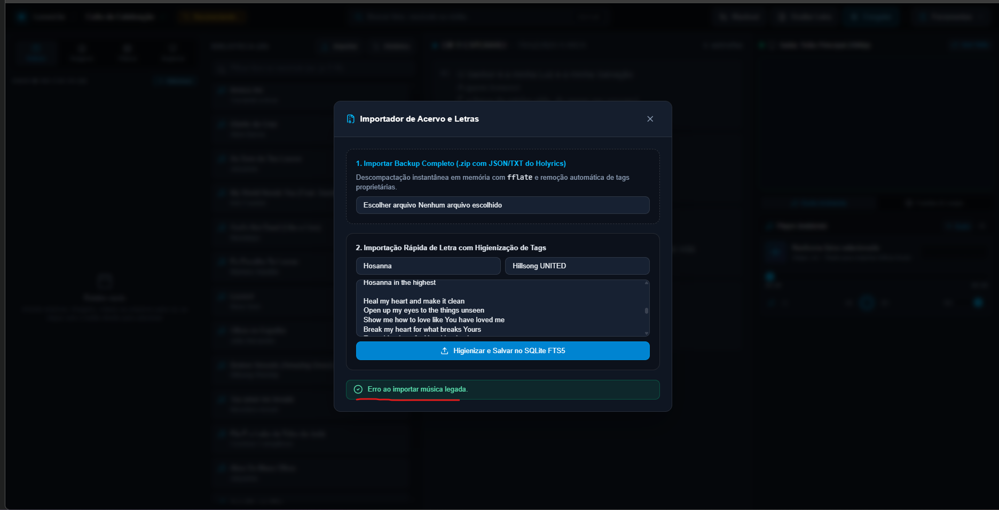

### BUG-10 — Editor de Música com Preview de Slides em Tempo Real e Fundo Associado
- **Severidade:** Alto | **Tipo:** Paridade com Holyrics Original | **Fase:** 3
- **Problema:** Ao cadastrar ou editar uma música, falta o mecanismo clássico de preview em tempo real do Holyrics que mostra cada slide lado a lado conforme o operador digita e quebra parágrafos com `Enter`. Também falta a opção de vincular um fundo padrão específico àquela música.
- **Arquivos envolvidos:**
  - [SongImporterModal.tsx](file:///home/miguelsb/workspace/holyrics-analysis/new-holyrics/slices/songs/ui/components/SongImporterModal.tsx)
  - [song-contracts.ts](file:///home/miguelsb/workspace/holyrics-analysis/new-holyrics/slices/songs/contracts/song-contracts.ts#L12-L20)
  - [song-repository.ts](file:///home/miguelsb/workspace/holyrics-analysis/new-holyrics/slices/songs/daemon/song-repository.ts#L29-L109)
  - [useOperatorController.ts](file:///home/miguelsb/workspace/holyrics-analysis/new-holyrics/apps/ui/src/operator/hooks/useOperatorController.ts#L87-L108)
  - Referência Java original: [MusicView.java](file:///home/miguelsb/workspace/holyrics-analysis/holyrics-source/legacy-java/com/limagiran/holyrics/view/MusicView.java#L94-L160)
- **Causa-raiz:** O modal atual não possui editor dividido com pré-visualização instantânea dos blocos separados por `Enter` duplo (`\n\n`) nem campo `defaultBackground` no `SongSchema` / banco SQLite.
- **Solução planejada:**
  1. Transformar o modal em um **Editor / Importador Lado a Lado** fiel ao `MusicView.java`: coluna esquerda com Título, Artista, Textarea de letra (onde cada linha em branco cria um novo slide) e seletor de **Fundo Associado**; coluna direita exibindo a **grade 16:9 ao vivo** de todos os slides conforme o usuário digita.
  2. Persistir `defaultBackground` na tabela `songs` e aplicá-lo automaticamente ao projetar a música em `useOperatorController.ts`.
- **Gabarito de referência ([13-holyrics-legacy-music-preview.png](file:///home/miguelsb/workspace/holyrics-analysis/bugs/media/13-holyrics-legacy-music-preview.png)):**

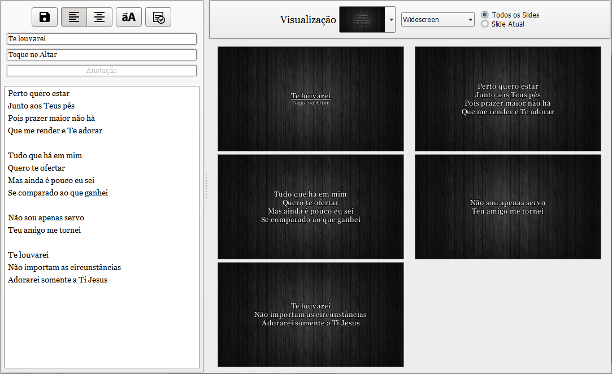

### BUG-11 — Busca e Importação de Letras Online 100% Sem Chaves de API
- **Severidade:** Alto | **Tipo:** Integração Externa / Quebra de API Legada | **Fase:** 3
- **Problema:** Falta uma interface funcional para buscar e importar letras da internet diretamente pelo aplicativo (semelhante à busca do Vagalume no Holyrics original), utilizando uma fonte gratuita que funcione hoje **100% sem necessidade de chaves de API**.
- **Arquivos envolvidos:**
  - [vagalume-client.ts](file:///home/miguelsb/workspace/holyrics-analysis/new-holyrics/slices/songs/daemon/vagalume-client.ts#L42-L153)
  - [vagalume-router.ts](file:///home/miguelsb/workspace/holyrics-analysis/new-holyrics/slices/songs/daemon/routes/vagalume-router.ts#L17-L62)
  - Referências Java originais: [VagalumeAPI.java](file:///home/miguelsb/workspace/holyrics-analysis/holyrics-source/legacy-java/com/limagiran/vagalumeapi/VagalumeAPI.java#L14-L52) e [MusicWebSearch.java](file:///home/miguelsb/workspace/holyrics-analysis/holyrics-source/legacy-java/com/limagiran/holyrics/view/MusicWebSearch.java#L288-L350)
- **Causa-raiz (Verificada em teste real):** A API usada pelo Holyrics original e por `vagalume-client.ts` (`https://api.vagalume.com.br/search.excerpt`) está retornando **HTTP 503 Service Temporarily Unavailable**, além de `search.php` exigir `apikey`/captcha. Por outro lado, testamos **LRCLIB (`https://lrclib.net/api/search`)** e **Letras.mus.br (`https://solr.sscdn.co/letras/m1/`)**, ambos respondendo **HTTP 200** sem nenhuma chave de API.
- **Solução planejada:**
  1. Atualizar o serviço de busca online em `vagalume-client.ts` / `vagalume-router.ts` para consultar **Letras.mus.br** (com parsing da página pública da letra) e **LRCLIB** (`plainLyrics`), 100% sem API Key.
  2. Adicionar aba **"Buscar na Internet"** dentro do modal de músicas (e botão na barra de Letras), permitindo pesquisar, pré-visualizar os slides e importar direto para o editor/acervo.

---

## Categoria 4 — Apresentações PDF & PowerPoint

### BUG-12 — Apresentação de PDF/PPTX mostra apenas texto sobre fundo ativo em vez do documento real
- **Severidade:** Crítico | **Tipo:** Bug de Renderização & Projeção | **Fase:** 4
- **Problema:** Ao iniciar uma apresentação de PDF ou PPTX enquanto há uma imagem de fundo ativa no telão, a projeção exibe apenas texto extraído sobreposto à imagem de fundo anterior em vez de renderizar o documento/slide real. Em apresentações, o foco deve ser exibir fielmente o conteúdo visual do arquivo importado, sem misturar fundos de músicas.
- **Arquivos envolvidos:**
  - [pptx-extractor.ts](file:///home/miguelsb/workspace/holyrics-analysis/new-holyrics/slices/pptx/daemon/pptx-extractor.ts#L92-L203)
  - [ProjectorScreen.tsx](file:///home/miguelsb/workspace/holyrics-analysis/new-holyrics/slices/navigation/ui/components/ProjectorScreen.tsx#L100-L150)
  - [ForegroundTextDisplay.tsx](file:///home/miguelsb/workspace/holyrics-analysis/new-holyrics/slices/navigation/ui/components/ForegroundTextDisplay.tsx)
  - [screen-state.ts](file:///home/miguelsb/workspace/holyrics-analysis/new-holyrics/packages/core/src/fsm/screen-state.ts#L22-L28)
- **Causa-raiz:**
  1. `extractPdfFromBuffer` tenta regex simples no binário PDF (que não lê fluxos comprimidos nem gráficos/layout) e `extractPptxFromBuffer` extrai apenas texto puro (ou cai em `"Slide 1"` quando o slide só contém imagens/formas).
  2. `ProjectorScreen.tsx#L100-L150` continua renderizando o `BackgroundVideoLoop` (imagem/vídeo ativo anteriormente) mesmo quando `mode === 'PPTX'`, sobrepondo apenas o texto em cima da foto de fundo anterior.
- **Solução planejada:**
  1. Suportar `imageUrl` (imagem/renderização do slide ou página do PDF) em `SlideItemSchema` e `PptxSlide`.
  2. No frontend, renderizar cada página de `.pdf` via `pdfjs-dist` em imagem de alta resolução durante a importação/preview, exibindo o preview visual de cada página no modal e no telão; para `.pptx`, extrair também imagens embutidas e layout/fundo dos slides.
  3. Em `ProjectorScreen.tsx`, quando `mode === 'PPTX'`, suprimir `BackgroundVideoLoop` (renderizando fundo próprio do slide ou preto neutro) e exibir a imagem/conteúdo fiel da lâmina em `object-contain`.
- **Mídias ([02-apresentar-pdf-iniciar-apresentacao.png](file:///home/miguelsb/workspace/holyrics-analysis/bugs/media/02-apresentar-pdf-iniciar-apresentacao.png) e [12-general-text-at-screen.png](file:///home/miguelsb/workspace/holyrics-analysis/bugs/media/12-general-text-at-screen.png)):**

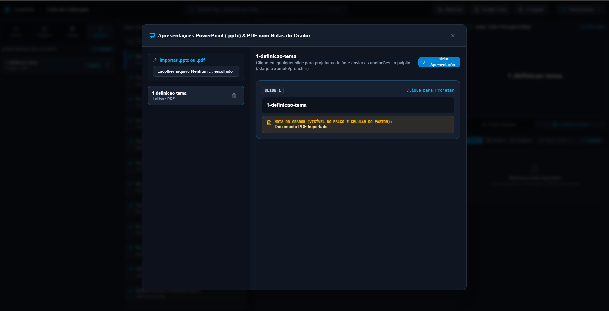

### BUG-13 — Botão "Iniciar Apresentação" sem reatividade e erro no `dag-runner` com OBS offline
- **Severidade:** Crítico | **Tipo:** Bug de UI & Backend Logger | **Fase:** 4
- **Problema:** O botão `"Iniciar Apresentação"` aparenta estar quebrado e não dá feedback visual ao ser clicado (não fecha o modal, não destaca o slide ativo nem exibe preview visual das lâminas). Além disso, o disparo da apresentação gera um erro `ERROR (dag-runner)` no log do servidor em segundo plano quando o OBS Studio não está conectado.
- **Arquivos envolvidos:**
  - [PptxDeckModal.tsx](file:///home/miguelsb/workspace/holyrics-analysis/new-holyrics/slices/pptx/ui/components/PptxDeckModal.tsx#L72-L94), [PptxDeckModal.tsx](file:///home/miguelsb/workspace/holyrics-analysis/new-holyrics/slices/pptx/ui/components/PptxDeckModal.tsx#L178-L181)
  - [dag-runner.ts](file:///home/miguelsb/workspace/holyrics-analysis/new-holyrics/slices/automation/daemon/dag-runner.ts#L216-L245)
  - [obs-client.ts](file:///home/miguelsb/workspace/holyrics-analysis/new-holyrics/slices/automation/daemon/obs-client.ts#L39-L108)
- **Causa-raiz:**
  1. Em `PptxDeckModal.tsx#L178-L181`, o botão `Iniciar Apresentação` não possui `whitespace-nowrap`, não fecha o modal nem destaca o slide em exibição, fazendo parecer que não reagiu ao clique; também falta renderização dos slides na coluna central do operador ao fechar o modal.
  2. No backend (`dag-runner.ts#L217-L244`), quando `ON_SLIDE_CHANGE` dispara, `executeObsAction` verifica apenas `if (!this.obsClient)` e chama `obsClient.sendRequest(...)` mesmo com o OBS desconectado, gerando o `ERROR (dag-runner): Falha não fatal na execução de nó DAG`.
- **Solução planejada:**
  1. Em `dag-runner.ts`, verificar o status de conexão do OBS (`!this.obsClient.getStatus().connected`) antes de tentar enviar requisição e registrar em log `debug` (não `error`) quando o OBS estiver offline.
  2. Em `PptxDeckModal.tsx` e `OperatorView.tsx`, fechar o modal (ou destacar o slide ativo com badge `"AO VIVO"` + controles Anterior/Próximo) e carregar os slides da apresentação na Coluna Central do operador para controle contínuo.
- **Mídia ([03-apresentar-pdf-backend-error.png](file:///home/miguelsb/workspace/holyrics-analysis/bugs/media/03-apresentar-pdf-backend-error.png)):**

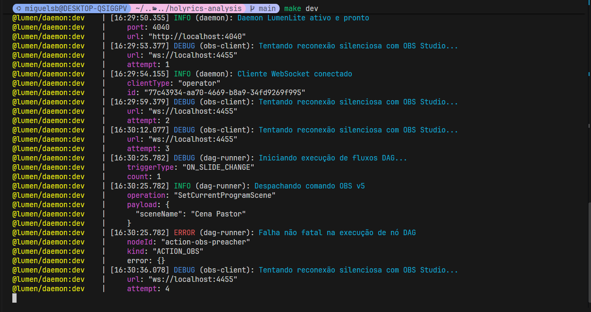

### BUG-14 — `"NOTA DO ORADOR: Documento PDF importado."` por padrão e menções a `/stage` e `/remote/preacher`
- **Severidade:** Médio | **Tipo:** UX / Vazamento de Detalhes Internos | **Fase:** 4
- **Problema:** Ao importar um arquivo PDF, surge automaticamente um bloco confuso com o aviso `"NOTA DO ORADOR (VISÍVEL NO PALCO E CELULAR DO PASTOR): Documento PDF importado."` sem que o usuário tenha inserido nenhuma nota. Além disso, o subtítulo do modal expõe rotas técnicas internas (`/stage` e `/remote/preacher`) que não agregam valor ao operador.
- **Arquivos envolvidos:**
  - [pptx-extractor.ts](file:///home/miguelsb/workspace/holyrics-analysis/new-holyrics/slices/pptx/daemon/pptx-extractor.ts#L186-L193)
  - [PptxDeckModal.tsx](file:///home/miguelsb/workspace/holyrics-analysis/new-holyrics/slices/pptx/ui/components/PptxDeckModal.tsx#L174-L214)
- **Causa-raiz:** `pptx-extractor.ts#L191` insere `speakerNotes: 'Documento PDF importado.'` por padrão quando não encontra linhas via regex, e `PptxDeckModal.tsx#L175` exibe `(/stage e /remote/preacher)` diretamente ao operador.
- **Solução planejada:** Remover o texto padrão `speakerNotes: 'Documento PDF importado.'` (deixar `speakerNotes: ''` quando não houver notas reais) e substituir a frase técnica por *"Clique em qualquer slide para projetar no telão"*.
- **Mídia ([02-apresentar-pdf-iniciar-apresentacao.png](file:///home/miguelsb/workspace/holyrics-analysis/bugs/media/02-apresentar-pdf-iniciar-apresentacao.png)):** veja preview em [BUG-12](#bug-12--apresenta%C3%A7%C3%A3o-de-pdfpptx-mostra-apenas-texto-sobre-fundo-ativo-em-vez-do-documento-real).

---

## Categoria 5 — Palco, Alertas Lower Thirds & Púlpito

### BUG-15 — Botão `minimal` sobreposto pelo campo `Duração (seg)`
- **Severidade:** Alto | **Tipo:** Bug de Layout CSS | **Fase:** 1
- **Problema:** No formulário de disparo de alertas, o campo numérico `Duração (seg)` invade o espaço do seletor de `Estilo`, sobrepondo visualmente o botão `minimal` e quebrando o alinhamento do card.
- **Arquivos envolvidos:**
  - [StageControlModal.tsx](file:///home/miguelsb/workspace/holyrics-analysis/new-holyrics/slices/stage/ui/components/StageControlModal.tsx#L128-L152)
- **Causa-raiz:** `grid grid-cols-2 gap-2` aloca 50% da largura para os 3 botões (`classic`, `urgent`, `minimal`), fazendo o último botão ultrapassar a coluna e ficar encoberto pelo `<Input type="number">` de `Duração (seg)`.
- **Solução planejada:** Colocar `Estilo` (`Clássico`, `Urgente`, `Discreto`) e `Duração (seg)` em blocos separados ou usar `flex flex-wrap items-end justify-between gap-3` garantindo zero colisão em qualquer largura.
- **Mídia ([01-disparar-alerta-overview.png](file:///home/miguelsb/workspace/holyrics-analysis/bugs/media/01-disparar-alerta-overview.png)):**

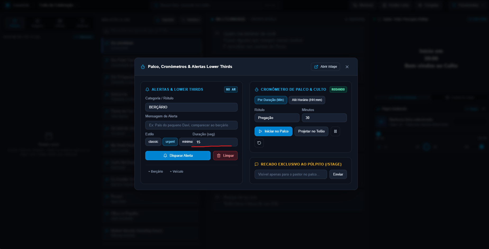

### BUG-16 — Disparar alerta sem mensagem não mostra erro de validação no formulário
- **Severidade:** Médio | **Tipo:** Bug de Validação / UX | **Fase:** 1
- **Problema:** Quando o operador clica em `"Disparar Alerta"` deixando o campo de mensagem em branco, o formulário não dispara o alerta nem exibe qualquer mensagem de erro ou indicação visual informando que o campo é obrigatório.
- **Arquivos envolvidos:**
  - [StageControlModal.tsx](file:///home/miguelsb/workspace/holyrics-analysis/new-holyrics/slices/stage/ui/components/StageControlModal.tsx#L48-L57) e [StageControlModal.tsx](file:///home/miguelsb/workspace/holyrics-analysis/new-holyrics/slices/stage/ui/components/StageControlModal.tsx#L121-L126)
- **Causa-raiz:** `handleTriggerAlert` retorna imediatamente (`if (!alertMessage.trim()) return`) sem definir estado de erro visual ou mensagem de validação inline.
- **Solução planejada:** Adicionar estado `alertError` exibindo mensagem vermelha abaixo do input `"Digite a mensagem do alerta para disparar."`, destaque na borda do campo e feedback de confirmação quando disparado.

### BUG-17 — Vazamento de rota técnica `/stage` no Modal de Palco e Alertas
- **Severidade:** Médio | **Tipo:** Poluição / Terminologia Técnica | **Fase:** 1
- **Problema:** Os textos do modal expõem detalhes internos de roteamento web (`/stage`) no botão `"Abrir /stage"` e no título `"RECADO EXCLUSIVO AO PÚLPITO (/STAGE)"`, poluindo a interface com termos técnicos desnecessários para o operador.
- **Arquivos envolvidos:**
  - [StageControlModal.tsx](file:///home/miguelsb/workspace/holyrics-analysis/new-holyrics/slices/stage/ui/components/StageControlModal.tsx#L93) e [StageControlModal.tsx](file:///home/miguelsb/workspace/holyrics-analysis/new-holyrics/slices/stage/ui/components/StageControlModal.tsx#L286)
- **Causa-raiz:** Strings literais `"Abrir /stage"` e `"Recado Exclusivo ao Púlpito (/stage)"` visíveis ao operador.
- **Solução planejada:** Alterar para `"Abrir Monitor de Palco"` e `"Recado Exclusivo ao Púlpito"`.

---

## Categoria 6 — Controle Remoto Mobile

### BUG-18 — Operador Remoto sem preview visual/carrossel e autenticação bypassed
- **Severidade:** Crítico | **Tipo:** Bug de Segurança & UI Mobile | **Fase:** 5
- **Problema:** A tela do Operador Remoto exibe apenas o texto puro do slide atual (ex.: `"Slide 1"`), sem mostrar um preview visual do telão nem permitir navegar pelos slides em formato de carrossel (deslizando no celular ou clicando/navegando lateralmente no computador). Além disso, a autenticação por token não está bloqueando acessos sem token válido.
- **Arquivos envolvidos:**
  - [OperatorRemoteView.tsx](file:///home/miguelsb/workspace/holyrics-analysis/new-holyrics/slices/remote/ui/components/OperatorRemoteView.tsx#L42-L192)
  - [PreacherRemoteView.tsx](file:///home/miguelsb/workspace/holyrics-analysis/new-holyrics/slices/remote/ui/components/PreacherRemoteView.tsx#L44-L120)
  - [App.tsx](file:///home/miguelsb/workspace/holyrics-analysis/new-holyrics/apps/ui/src/App.tsx#L35-L41)
  - [RemotePairingModal.tsx](file:///home/miguelsb/workspace/holyrics-analysis/new-holyrics/slices/remote/ui/components/RemotePairingModal.tsx#L184-L196)
  - [remote-router.ts](file:///home/miguelsb/workspace/holyrics-analysis/new-holyrics/slices/remote/daemon/routes/remote-router.ts#L50-L88)
- **Causa-raiz:**
  1. `App.tsx#L35-L41` injeta `useCommandDispatch()` (WebSocket direto sem autenticação) em `OperatorRemoteView` e `PreacherRemoteView`, ignorando completamente o `?token=` e o RBAC de `/api/remote/dispatch`. Além disso, `RemotePairingModal.tsx#L188` abre `/remote/operator` sem passar o `?token=`.
  2. `OperatorRemoteView.tsx#L145-L152` exibe apenas um bloco de texto cru sem `ProjectorScreen` (`isPreview`) nem carrossel com todos os slides do item atual.
- **Solução planejada:**
  1. Validar o token da URL (`?token=...`) contra novo endpoint `GET /api/remote/verify?token=...` e rotear comandos das views remotas via `POST /api/remote/dispatch` com token obrigatório (exibindo tela de acesso negado / campo para token se ausente ou inválido).
  2. Corrigir o botão `"Abrir em Nova Aba"` em `RemotePairingModal.tsx` para usar `activeUrl` (que já inclui `?token=...`).
  3. Adicionar **Mini-Preview 16:9 ao Vivo** (`<ProjectorScreen isPreview />`) + **Carrossel Horizontal de Slides** com scroll-snap/swipe no mobile e setas de navegação no desktop, permitindo visualizar e saltar para qualquer slide (`NAV_GOTO`).
- **Mídia ([06-remote-control-operator.png](file:///home/miguelsb/workspace/holyrics-analysis/bugs/media/06-remote-control-operator.png)):**

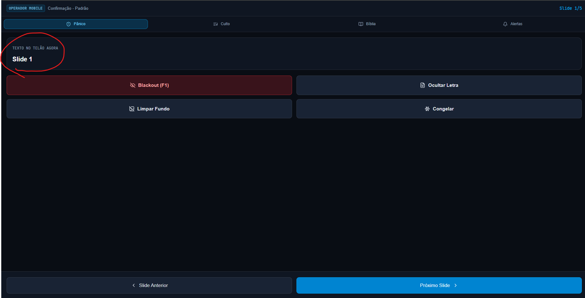

### BUG-19 — Configurações do Servidor Remoto (Ligar/Desligar, Startup, Seleção de IP LAN / `0.0.0.0`) e QR Code Real
- **Severidade:** Alto | **Tipo:** Bug de Rede / QR Code / Configuração | **Fase:** 5
- **Problema:** O painel de controle remoto seleciona automaticamente um IP link-local inacessível (`169.254.83.107`), gera um QR Code sintético ilegível e não oferece controles de configuração essenciais: ligar/desligar o servidor remoto manualmente, definir se ele inicia junto com o aplicativo no startup (ligado por padrão) e escolher o endereço IP entre as interfaces de rede disponíveis do computador ou `0.0.0.0`.
- **Arquivos envolvidos:**
  - [remote-auth.ts](file:///home/miguelsb/workspace/holyrics-analysis/new-holyrics/slices/remote/daemon/remote-auth.ts#L25-L94)
  - [remote-router.ts](file:///home/miguelsb/workspace/holyrics-analysis/new-holyrics/slices/remote/daemon/routes/remote-router.ts#L34-L88)
  - [RemotePairingModal.tsx](file:///home/miguelsb/workspace/holyrics-analysis/new-holyrics/slices/remote/ui/components/RemotePairingModal.tsx#L26-L168)
- **Causa-raiz:**
  1. `detectLocalLanIp()` retorna a primeira interface não-interna sem ignorar faixas APIPA (`169.254.x.x`), exibindo `169.254.83.107` no print abaixo.
  2. `buildDeterministicMatrix()` gera um padrão pseudoaleatório por hash que não segue o padrão ISO/IEC 18004, logo não é legível por câmeras de celular.
  3. Não existe API nem UI de configuração para habilitar/desabilitar o serviço remoto, definir comportamento no startup ou escolher a interface de rede (`0.0.0.0` ou IP específico).
- **Solução planejada:**
  1. Implementar enumeração de todas as interfaces IPv4 em `remote-auth.ts` (priorizando `192.168.*` / `10.*` / `172.16-31.*` sobre `169.254.*`) + opção `0.0.0.0`.
  2. Persistir configurações remotas (`enabled`, `autoStart`, `selectedHost`) com endpoints `GET/PUT /api/remote/config`, respeitando `enabled` em `authorizeCommand` e `/api/remote/*`.
  3. Substituir `buildDeterministicMatrix` por biblioteca/gerador real de QR Code SVG.
- **Mídia ([07-remote-control-pairing-modal.png](file:///home/miguelsb/workspace/holyrics-analysis/bugs/media/07-remote-control-pairing-modal.png)):**

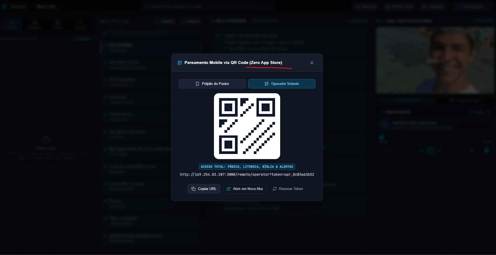

### BUG-20 — Texto `"Zero App Store"` vazando detalhe irrelevante no modal de controle remoto
- **Severidade:** Médio | **Tipo:** Poluição / UX | **Fase:** 5
- **Problema:** O título do modal exibe `"Pareamento Mobile via QR Code (Zero App Store)"`, incluindo uma expressão promocional/técnica que não agrega clareza ao operador.
- **Arquivos envolvidos:**
  - [RemotePairingModal.tsx](file:///home/miguelsb/workspace/holyrics-analysis/new-holyrics/slices/remote/ui/components/RemotePairingModal.tsx#L121-L123)
- **Causa-raiz:** Título hardcoded `"Pareamento Mobile via QR Code (Zero App Store)"`.
- **Solução planejada:** Alterar para `"Controle Remoto Mobile"`.
- **Mídia ([07-remote-control-pairing-modal.png](file:///home/miguelsb/workspace/holyrics-analysis/bugs/media/07-remote-control-pairing-modal.png)):** veja preview em [BUG-19](#bug-19--configura%C3%A7%C3%B5es-do-servidor-remoto-ligardesligar-startup-sele%C3%A7%C3%A3o-de-ip-lan--0000-e-qr-code-real).

---

## Categoria 7 — Editor de Automações DAG & OBS Studio

### BUG-21 — Editor de Automações sem edição de nós, menu de botão direito, separação de regras e histórico
- **Severidade:** Alto | **Tipo:** Feature Incompleta / Interatividade | **Fase:** 6
- **Problema:** O editor visual de automações não é interativo: não permite editar as propriedades dos nós nem clicar com o botão direito para deletar, duplicar ou configurar ações. Além disso, falta feedback visual ao testar fluxos, não há histórico de execução e não está claro para o usuário como múltiplas automações são separadas e organizadas.
- **Arquivos envolvidos:**
  - [CustomNodes.tsx](file:///home/miguelsb/workspace/holyrics-analysis/new-holyrics/slices/automation/ui/components/CustomNodes.tsx#L31-L203)
  - [AutomationCanvas.tsx](file:///home/miguelsb/workspace/holyrics-analysis/new-holyrics/slices/automation/ui/components/AutomationCanvas.tsx#L49-L333)
  - [AutomationModal.tsx](file:///home/miguelsb/workspace/holyrics-analysis/new-holyrics/slices/automation/ui/components/AutomationModal.tsx#L30-L140)
  - [dag-runner.ts](file:///home/miguelsb/workspace/holyrics-analysis/new-holyrics/slices/automation/daemon/dag-runner.ts#L64-L156)
- **Causa-raiz:**
  1. Os nós em `CustomNodes.tsx` apenas exibem texto estático; `AutomationCanvas.tsx` não possui `onNodeClick`, `onNodeContextMenu`, `onEdgeContextMenu` nem painel de edição de propriedades do nó selecionado.
  2. Toda a automação reside em um único grafo sem lista/abas para separar regras diferentes (ex.: `"Troca automática OBS"` vs `"Pânico / Luzes"`).
  3. `onTestTrigger` em `AutomationModal.tsx#L87-L93` faz `fetch('/api/automation/test-trigger')` sem retornar nem mostrar feedback visual na UI, e o `DagRunner` não mantém um buffer de histórico de execuções consultável.
- **Solução planejada:**
  1. Adicionar **Menu de Contexto (botão direito)** sobre nós e conexões com ações: `Editar Propriedades`, `Duplicar Nó` e `Excluir`.
  2. Adicionar **Painel Inspector Lateral** ao clicar em um nó para editar nome, tipo de gatilho, condição (`campo`, `operador`, `valor`), cena/ação OBS, URL/método HTTP e tempo de delay.
  3. Estruturar suporte a **múltiplas regras/fluxos independentes** com barra lateral de seleção (criar, renomear, ativar/desativar, excluir fluxo).
  4. Registrar **Histórico de Execuções** no `DagRunner` (com timestamp, gatilho, nós executados, sucesso/erro/ignorado) e exibi-lo em aba dedicada no modal junto com feedback visual de `"Testar Fluxo"`.
- **Mídia ([04-editor-automacoes-overview.png](file:///home/miguelsb/workspace/holyrics-analysis/bugs/media/04-editor-automacoes-overview.png)):**

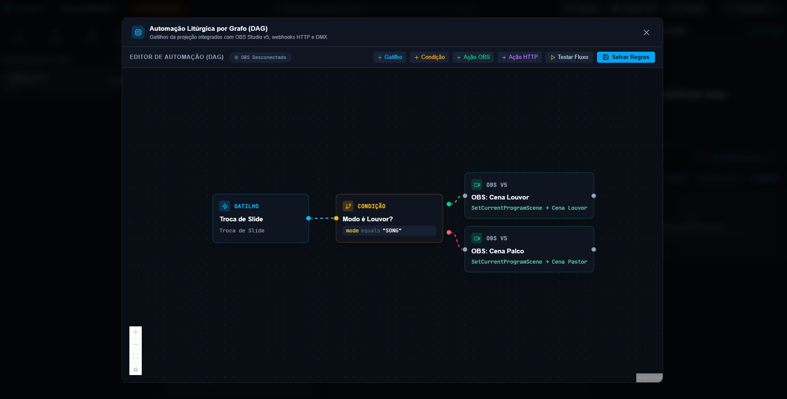

---

## Plano de Execução em Fases

1. **Fase 1 — Correções Rápidas de UI, Teclado, Alertas & Cabeçalho**
   - `BUG-01` (Fechar Command Palette com `Esc` / clique fora)
   - `BUG-04` (Menu de ações no Nome do Evento: Exportar, Importar, Novo Culto)
   - `BUG-05` (Cronômetro progressivo desde a projeção do slide/item)
   - `BUG-09` (Remover jargões e corrigir banner de erro verde para vermelho no Importador)
   - `BUG-15`, `BUG-16`, `BUG-17` (Overlap de botões, validação de mensagem vazia e remoção de `/stage`)
2. **Fase 2 — Layout Redimensionável, Unificação de Letras, Preview de Mídias, Áudio & Pastas**
   - `BUG-02` (Unificar aba `Letras` na Coluna Esquerda e eliminar coluna avulsa)
   - `BUG-03` (SplitPanes redimensionáveis horizontal e verticalmente)
   - `BUG-06` (Miniaturas reais ``/`<video>` + Lightbox de preview)
   - `BUG-07` (Drag & Drop universal do PC e entre todas as abas para o Roteiro)
   - `BUG-08` (Pastas, renomear, deletar, botão Abrir Pasta Local no SO e suporte a Áudio)
3. **Fase 3 — Editor Visual de Músicas com Preview 16:9 e Busca Web Sem API Key**
   - `BUG-10` (Editor estilo `MusicView.java` com preview 16:9 por parágrafo e Fundo Associado)
   - `BUG-11` (Busca de letras online sem API key via LRCLIB + Letras.mus.br)
4. **Fase 4 — Apresentações PDF e PPTX Fiéis**
   - `BUG-12` (Renderização visual de páginas PDF/slides PPTX sem fundo musical sobreposto)
   - `BUG-13` (Reatividade do botão Iniciar Apresentação + proteção do `dag-runner` quando OBS offline)
   - `BUG-14` (Remover nota fake `"Documento PDF importado."` e menções `/stage` / `/remote/preacher`)
5. **Fase 5 — Controle Remoto Mobile, Autenticação, Carrossel & Rede**
   - `BUG-18` (Validação real de token, Preview 16:9 e Carrossel deslizável de slides)
   - `BUG-19` (Ligar/Desligar servidor remoto, Startup, seletor de IP LAN/`0.0.0.0`, QR Code real)
   - `BUG-20` (Remover `"Zero App Store"`)
6. **Fase 6 — Editor de Automações Interativo & Histórico**
   - `BUG-21` (Menu de botão direito, Inspector de nós, múltiplas regras e histórico de execuções)

