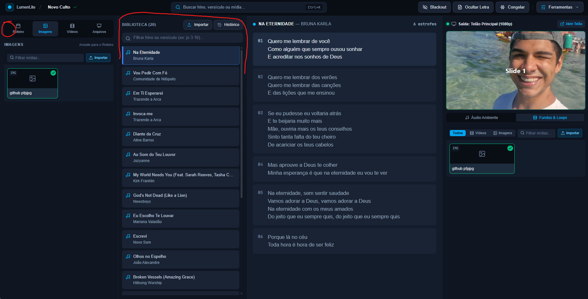

# BUG-002 — Unificar a Biblioteca de Letras na Coluna Esquerda (`unify-lyrics`)

- **Status:** Closed

- **Severidade:** Alto | **Tipo:** Arquitetura de UI / Layout | **Fase:** 2
- **Problema:** A biblioteca de músicas (`Biblioteca`) ocupa uma coluna inteira avulsa no console, desperdiçando espaço horizontal. As músicas deveriam ficar integradas como mais uma aba na coluna esquerda (`LiturgyScheduleColumn`) ao lado de **Roteiro**, **Imagens**, **Vídeos** e **Arquivos**, permitindo buscar e selecionar hinos diretamente por lá.
- **Arquivos envolvidos:**
  - [OperatorView.tsx](../../new-holyrics/apps/ui/src/operator/OperatorView.tsx#L143-L214)
  - [LiturgyScheduleColumn.tsx](../../new-holyrics/slices/liturgy/ui/components/LiturgyScheduleColumn.tsx#L30)
  - [SongSearchList.tsx](../../new-holyrics/slices/songs/ui/components/SongSearchList.tsx#L23-L115)
  - [BibleQuickLookupCard.tsx](../../new-holyrics/slices/bible/ui/components/BibleQuickLookupCard.tsx)
- **Causa-raiz:** Em `OperatorView.tsx#L143`, o grid principal fixa 4 colunas (`20fr 22fr 33fr 25fr`), mantendo a Coluna 2 (`Biblioteca`) isolada de `LiturgyScheduleColumn.tsx` (Coluna 1).
- **Solução planejada:**
  1. Adicionar a aba `LETRAS` (e `AUDIO`) em `LiturgyScheduleColumn.tsx` contendo o campo de busca de hino/versículo, botões `Importar` e `Histórico`, `BibleQuickLookupCard` e `SongSearchList`.
  2. Remover a Coluna 2 avulsa de `OperatorView.tsx`, migrando o layout principal para 3 colunas fluidas (`Navegador Esquerdo` | `Palco Central de Slides` | `Monitor de Saída Direito`).
- **Mídia ([10-roteiro-unify-lyrics.png](../media/10-roteiro-unify-lyrics.png)):**

