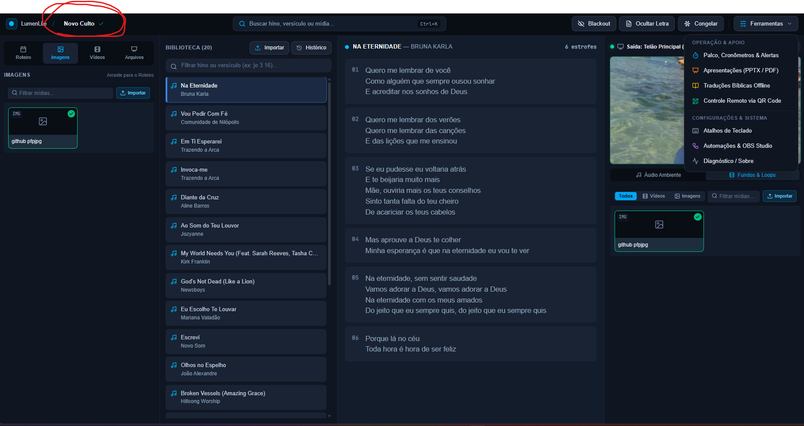

# BUG-004 — Utilidade do Nome do Evento no topo e Exportação/Importação de Roteiro

- **Status:** Closed

- **Severidade:** Médio | **Tipo:** Funcionalidade Incompleta / UX | **Fase:** 1
- **Problema:** O campo de nome do evento na barra superior (ex.: `"Novo Culto"`) não deixa claro qual é a sua finalidade — não indica se ele representa um roteiro salvo que pode ser exportado, importado posteriormente ou alternado entre diferentes cultos.
- **Arquivos envolvidos:**
  - [OperatorTopBar.tsx](../../new-holyrics/slices/navigation/ui/components/OperatorTopBar.tsx#L107-L138)
  - [liturgy-router.ts](../../new-holyrics/slices/liturgy/daemon/routes/liturgy-router.ts#L43-L120)
  - [liturgy-repository.ts](../../new-holyrics/slices/liturgy/daemon/liturgy-repository.ts#L68-L100)
- **Causa-raiz:** `OperatorTopBar.tsx#L107-L138` apenas altera a propriedade `title` dentro de `culto.json` via `/api/liturgy/title`, sem expor ao operador o vínculo com o roteiro do culto nem ações de exportar, importar ou iniciar novo culto.
- **Solução planejada:** Transformar a área do nome do evento em um botão com menu de ações do roteiro: **Renomear Culto**, **Exportar Roteiro (`.json`)**, **Importar Roteiro (`.json`)** e **Novo Culto (limpar roteiro)**.
- **Mídia ([11-general-event-name.png](../media/11-general-event-name.png)):**

