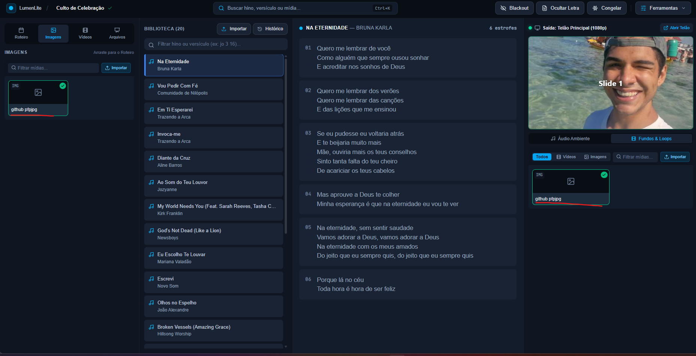

# BUG-006 — Preview de imagens não carrega nos cards e falta visualização ampliada

- **Status:** Closed

- **Severidade:** Alto | **Tipo:** Bug Visual / Funcionalidade | **Fase:** 2
- **Problema:** Os cards de mídia exibem apenas um ícone genérico no lugar da miniatura real da imagem/vídeo, dificultando a identificação visual do arquivo. Além disso, falta uma opção para abrir o preview ampliado da imagem antes de projetá-la no telão.
- **Arquivos envolvidos:**
  - [MediaGridPanel.tsx](../../new-holyrics/slices/media/ui/components/MediaGridPanel.tsx#L233-L259)
- **Causa-raiz:** Em `MediaGridPanel.tsx#L233-L239`, embora `streamUrl` (`/api/media/stream/:id`) exista na linha 207 e funcione perfeitamente no telão, o card renderiza apenas `<Film />` ou `<ImageIcon />` no lugar de uma miniatura `` / `<video>`.
- **Solução planejada:**
  1. Renderizar `` para imagens e `<video src={streamUrl} preload="metadata" muted className="h-full w-full object-cover" />` para vídeos.
  2. Adicionar botão e opção no menu de contexto **"Visualizar Preview"** (modal Lightbox) para inspecionar a mídia em tela antes de enviá-la ao telão.
- **Mídia ([09-roteiro-image-preview-not-loading.png](../media/09-roteiro-image-preview-not-loading.png)):**

