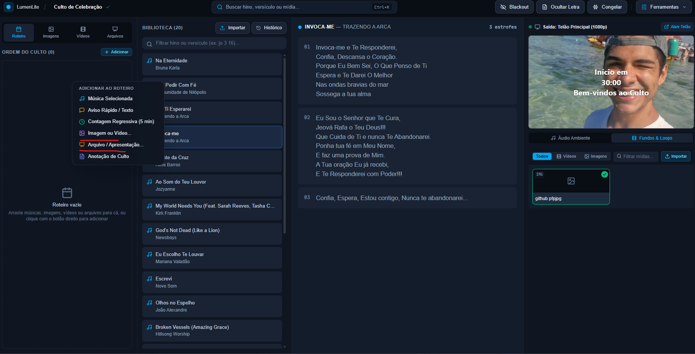

# BUG-008 — Gerenciamento de pastas/arquivos (criar, renomear, deletar, abrir local no SO) e suporte a Áudio

- **Status:** Closed

- **Severidade:** Médio | **Tipo:** Feature / Organização de Acervo | **Fase:** 2
- **Problema:** Faltam recursos básicos de organização nas bibliotecas de mídia e arquivos: não é possível criar pastas, renomear ou deletar arquivos/pastas em cada grupo, nem há uma opção para abrir a pasta local no explorador de arquivos do computador para adicionar arquivos em lote. Além disso, falta suporte/aba dedicada para arquivos de **Áudio** ao lado de Imagens, Vídeos e Arquivos, mantendo o Roteiro capaz de receber qualquer tipo de mídia misturado.

- **Arquivos envolvidos:**
  - [LiturgyScheduleColumn.tsx](../../new-holyrics/slices/liturgy/ui/components/LiturgyScheduleColumn.tsx#L30), [LiturgyScheduleColumn.tsx](../../new-holyrics/slices/liturgy/ui/components/LiturgyScheduleColumn.tsx#L192-L250)
  - [MediaGridPanel.tsx](../../new-holyrics/slices/media/ui/components/MediaGridPanel.tsx#L59-L70)
  - [media-repository.ts](../../new-holyrics/slices/media/daemon/media-repository.ts#L108-L253)
  - [media-router.ts](../../new-holyrics/slices/media/daemon/routes/media-router.ts#L140-L220)
- **Causa-raiz:** `MediaRepository` apenas varre recursivamente a pasta raiz no boot sem expor subpastas virtuais/físicas, não tem endpoints para `mkdir`, `rename` ou `open-folder` no sistema operacional, e `MediaGridPanel.tsx#L61` filtra `if (item.type === 'AUDIO') return false`.
- **Solução planejada:**
  1. Manter as abas distintas por tipo na Coluna 1 (**Roteiro | Letras | Imagens | Vídeos | Áudio | Arquivos**), garantindo que o **Roteiro** aceite qualquer tipo misturado em sequência de culto.
  2. No backend (`media-repository.ts` + `media-router.ts` + `pptx-router.ts`): implementar endpoints para **Criar Pasta**, **Renomear Arquivo/Pasta**, **Excluir**, **Reescanear Diretório** e **Abrir Pasta Local no Explorador do SO** (`xdg-open` / `explorer` / `open`).
  3. Adicionar menu de contexto (botão direito) em cada card e pasta dentro das abas de Imagens, Vídeos, Áudio e Arquivos.
- **Mídia ([08-roteiro-card-right-click.png](../media/08-roteiro-card-right-click.png)):**

