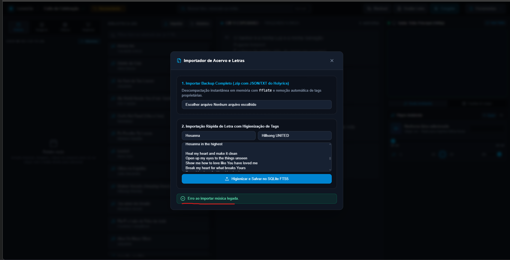

# BUG-009 — Textos developer-centric, erro de importação exibido em verde e cache desatualizado

- **Status:** Closed

- **Severidade:** Médio | **Tipo:** Bug Visual / UX / Cache | **Fase:** 1 / 3
- **Problema:** O modal de importação de músicas exibe jargões técnicos voltados para desenvolvedores (como `"SQLite FTS5"`, `"fflate"` e `"tags proprietárias"`) que não fazem sentido para o operador da igreja. Além disso, quando ocorre uma falha na importação, a mensagem de erro é exibida em uma caixa verde com ícone de confirmação (`✓`), parecendo uma operação bem-sucedida, e a lista de músicas não é atualizada automaticamente após importar.
- **Arquivos envolvidos:**
  - [SongImporterModal.tsx](../../new-holyrics/slices/songs/ui/components/SongImporterModal.tsx#L110-L154)
  - [OperatorView.tsx](../../new-holyrics/apps/ui/src/operator/OperatorView.tsx#L284-L287)
- **Causa-raiz:**
  1. Strings técnicas explícitas em `SongImporterModal.tsx#L115` (`fflate`, `tags proprietárias`) e `#L145` (`SQLite FTS5`).
  2. O banner de status (`SongImporterModal.tsx#L149-L154`) sempre renderiza fundo verde (`emerald-500`) e ícone `<CheckCircle2 />`, mesmo quando ocorre erro no `catch` (`"Erro ao importar música legada."`).
  3. `OperatorView.tsx#L284-L287` renderiza `<SongImporterModal>` sem passar `onImported`, deixando de invalidar o cache `songKeys.all` do TanStack Query após salvar.
- **Solução planejada:** Substituir textos técnicos por linguagem natural do operador (ex.: *"Importar backup completo do Holyrics (.zip)"* e *"Salvar Música"*), usar estado estruturado `{ type: 'success' | 'error', text: string }` com ícone/cor vermelha (`rose`) para erros e invalidar `songKeys.all` ao concluir.
- **Mídia ([05-importar-musica-nova.png](../media/05-importar-musica-nova.png)):**

