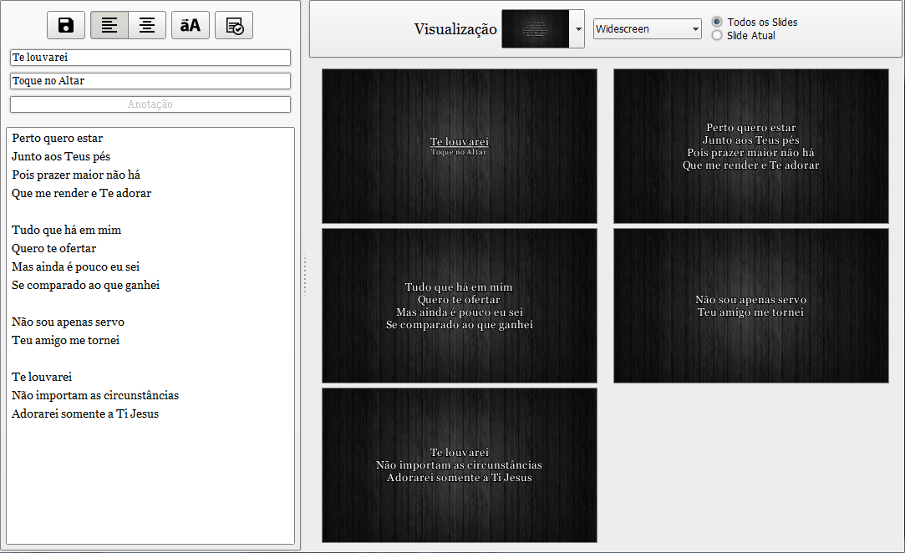

# BUG-010 — Editor de Música com Preview de Slides em Tempo Real e Fundo Associado

- **Status:** Closed

- **Severidade:** Alto | **Tipo:** Paridade com Holyrics Original | **Fase:** 3
- **Problema:** Ao cadastrar ou editar uma música, falta o mecanismo clássico de preview em tempo real do Holyrics que mostra cada slide lado a lado conforme o operador digita e quebra parágrafos com `Enter`. Também falta a opção de vincular um fundo padrão específico àquela música.
- **Arquivos envolvidos:**
  - [SongImporterModal.tsx](../../new-holyrics/slices/songs/ui/components/SongImporterModal.tsx)
  - [song-contracts.ts](../../new-holyrics/slices/songs/contracts/song-contracts.ts#L12-L20)
  - [song-repository.ts](../../new-holyrics/slices/songs/daemon/song-repository.ts#L29-L109)
  - [useOperatorController.ts](../../new-holyrics/apps/ui/src/operator/hooks/useOperatorController.ts#L87-L108)
  - Referência Java original: [MusicView.java](../../holyrics-source/legacy-java/com/limagiran/holyrics/view/MusicView.java#L94-L160)
- **Causa-raiz:** O modal atual não possui editor dividido com pré-visualização instantânea dos blocos separados por `Enter` duplo (`\n\n`) nem campo `defaultBackground` no `SongSchema` / banco SQLite.
- **Solução planejada:**
  1. Transformar o modal em um **Editor / Importador Lado a Lado** fiel ao `MusicView.java`: coluna esquerda com Título, Artista, Textarea de letra (onde cada linha em branco cria um novo slide) e seletor de **Fundo Associado**; coluna direita exibindo a **grade 16:9 ao vivo** de todos os slides conforme o usuário digita.
  2. Persistir `defaultBackground` na tabela `songs` e aplicá-lo automaticamente ao projetar a música em `useOperatorController.ts`.
- **Gabarito de referência ([13-holyrics-legacy-music-preview.png](../media/13-holyrics-legacy-music-preview.png)):**

