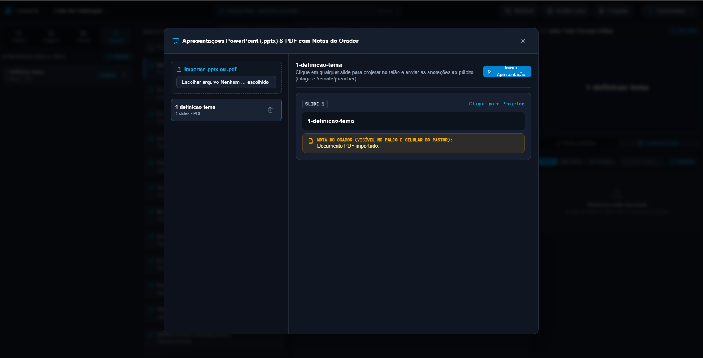
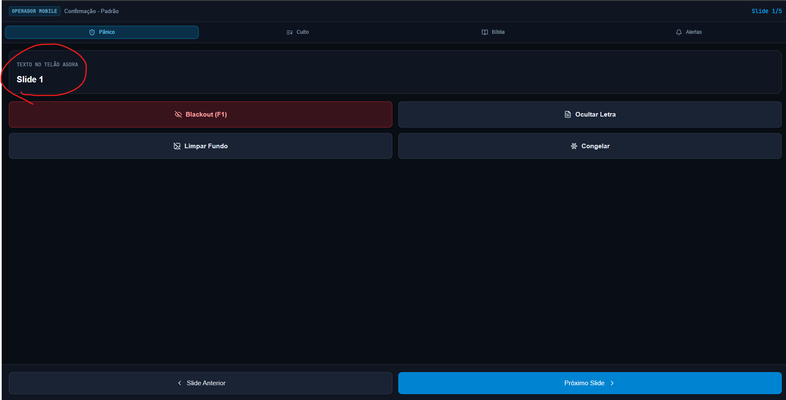

# BUG-012 — Apresentação de PDF/PPTX mostra apenas texto sobre fundo ativo em vez do documento real

- **Status:** Closed

- **Severidade:** Crítico | **Tipo:** Bug de Renderização & Projeção | **Fase:** 4
- **Problema:** Ao iniciar uma apresentação de PDF ou PPTX enquanto há uma imagem de fundo ativa no telão, a projeção exibe apenas texto extraído sobreposto à imagem de fundo anterior em vez de renderizar o documento/slide real. Em apresentações, o foco deve ser exibir fielmente o conteúdo visual do arquivo importado, sem misturar fundos de músicas.
- **Arquivos envolvidos:**
  - [pptx-extractor.ts](../../new-holyrics/slices/pptx/daemon/pptx-extractor.ts#L92-L203)
  - [ProjectorScreen.tsx](../../new-holyrics/slices/navigation/ui/components/ProjectorScreen.tsx#L100-L150)
  - [ForegroundTextDisplay.tsx](../../new-holyrics/slices/navigation/ui/components/ForegroundTextDisplay.tsx)
  - [screen-state.ts](../../new-holyrics/packages/core/src/fsm/screen-state.ts#L22-L28)
- **Causa-raiz:**
  1. `extractPdfFromBuffer` tenta regex simples no binário PDF (que não lê fluxos comprimidos nem gráficos/layout) e `extractPptxFromBuffer` extrai apenas texto puro (ou cai em `"Slide 1"` quando o slide só contém imagens/formas).
  2. `ProjectorScreen.tsx#L100-L150` continua renderizando o `BackgroundVideoLoop` (imagem/vídeo ativo anteriormente) mesmo quando `mode === 'PPTX'`, sobrepondo apenas o texto em cima da foto de fundo anterior.
- **Solução planejada:**
  1. Suportar `imageUrl` (imagem/renderização do slide ou página do PDF) em `SlideItemSchema` e `PptxSlide`.
  2. No frontend, renderizar cada página de `.pdf` via `pdfjs-dist` em imagem de alta resolução durante a importação/preview, exibindo o preview visual de cada página no modal e no telão; para `.pptx`, extrair também imagens embutidas e layout/fundo dos slides.
  3. Em `ProjectorScreen.tsx`, quando `mode === 'PPTX'`, suprimir `BackgroundVideoLoop` (renderizando fundo próprio do slide ou preto neutro) e exibir a imagem/conteúdo fiel da lâmina em `object-contain`.
- **Mídias ([02-apresentar-pdf-iniciar-apresentacao.png](../media/02-apresentar-pdf-iniciar-apresentacao.png) e [12-general-text-at-screen.png](../media/12-general-text-at-screen.png)):**

