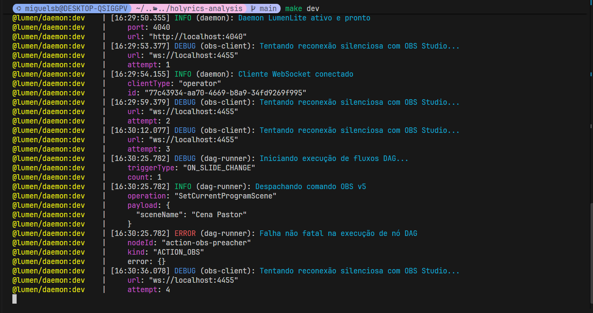

# BUG-013 — Botão "Iniciar Apresentação" sem reatividade e erro no `dag-runner` com OBS offline

- **Status:** Closed

- **Severidade:** Crítico | **Tipo:** Bug de UI & Backend Logger | **Fase:** 4
- **Problema:** O botão `"Iniciar Apresentação"` aparenta estar quebrado e não dá feedback visual ao ser clicado (não fecha o modal, não destaca o slide ativo nem exibe preview visual das lâminas). Além disso, o disparo da apresentação gera um erro `ERROR (dag-runner)` no log do servidor em segundo plano quando o OBS Studio não está conectado.
- **Arquivos envolvidos:**
  - [PptxDeckModal.tsx](../../new-holyrics/slices/pptx/ui/components/PptxDeckModal.tsx#L72-L94), [PptxDeckModal.tsx](../../new-holyrics/slices/pptx/ui/components/PptxDeckModal.tsx#L178-L181)
  - [dag-runner.ts](../../new-holyrics/slices/automation/daemon/dag-runner.ts#L216-L245)
  - [obs-client.ts](../../new-holyrics/slices/automation/daemon/obs-client.ts#L39-L108)
- **Causa-raiz:**
  1. Em `PptxDeckModal.tsx#L178-L181`, o botão `Iniciar Apresentação` não possui `whitespace-nowrap`, não fecha o modal nem destaca o slide em exibição, fazendo parecer que não reagiu ao clique; também falta renderização dos slides na coluna central do operador ao fechar o modal.
  2. No backend (`dag-runner.ts#L217-L244`), quando `ON_SLIDE_CHANGE` dispara, `executeObsAction` verifica apenas `if (!this.obsClient)` e chama `obsClient.sendRequest(...)` mesmo com o OBS desconectado, gerando o `ERROR (dag-runner): Falha não fatal na execução de nó DAG`.
- **Solução planejada:**
  1. Em `dag-runner.ts`, verificar o status de conexão do OBS (`!this.obsClient.getStatus().connected`) antes de tentar enviar requisição e registrar em log `debug` (não `error`) quando o OBS estiver offline.
  2. Em `PptxDeckModal.tsx` e `OperatorView.tsx`, fechar o modal (ou destacar o slide ativo com badge `"AO VIVO"` + controles Anterior/Próximo) e carregar os slides da apresentação na Coluna Central do operador para controle contínuo.
- **Mídia ([03-apresentar-pdf-backend-error.png](../media/03-apresentar-pdf-backend-error.png)):**

