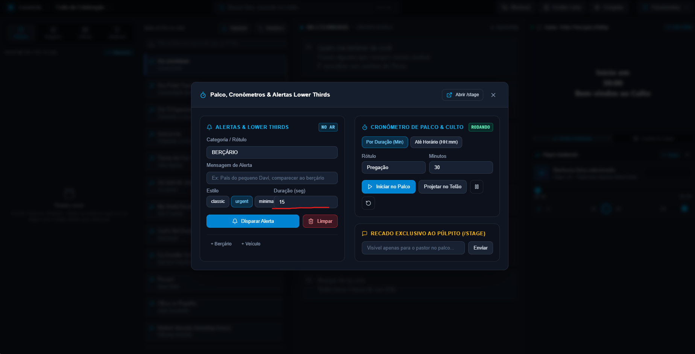

# BUG-015 — Botão `minimal` sobreposto pelo campo `Duração (seg)`

- **Status:** Closed

- **Severidade:** Alto | **Tipo:** Bug de Layout CSS | **Fase:** 1
- **Problema:** No formulário de disparo de alertas, o campo numérico `Duração (seg)` invade o espaço do seletor de `Estilo`, sobrepondo visualmente o botão `minimal` e quebrando o alinhamento do card.
- **Arquivos envolvidos:**
  - [StageControlModal.tsx](../../new-holyrics/slices/stage/ui/components/StageControlModal.tsx#L128-L152)
- **Causa-raiz:** `grid grid-cols-2 gap-2` aloca 50% da largura para os 3 botões (`classic`, `urgent`, `minimal`), fazendo o último botão ultrapassar a coluna e ficar encoberto pelo `<Input type="number">` de `Duração (seg)`.
- **Solução planejada:** Colocar `Estilo` (`Clássico`, `Urgente`, `Discreto`) e `Duração (seg)` em blocos separados ou usar `flex flex-wrap items-end justify-between gap-3` garantindo zero colisão em qualquer largura.
- **Mídia ([01-disparar-alerta-overview.png](../media/01-disparar-alerta-overview.png)):**

