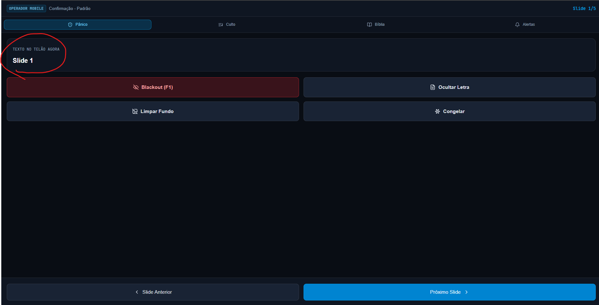

# BUG-018 — Operador Remoto sem preview visual/carrossel e autenticação bypassed

- **Status:** Closed

- **Severidade:** Crítico | **Tipo:** Bug de Segurança & UI Mobile | **Fase:** 5
- **Problema:** A tela do Operador Remoto exibe apenas o texto puro do slide atual (ex.: `"Slide 1"`), sem mostrar um preview visual do telão nem permitir navegar pelos slides em formato de carrossel (deslizando no celular ou clicando/navegando lateralmente no computador). Além disso, a autenticação por token não está bloqueando acessos sem token válido.
- **Arquivos envolvidos:**
  - [OperatorRemoteView.tsx](../../new-holyrics/slices/remote/ui/components/OperatorRemoteView.tsx#L42-L192)
  - [PreacherRemoteView.tsx](../../new-holyrics/slices/remote/ui/components/PreacherRemoteView.tsx#L44-L120)
  - [App.tsx](../../new-holyrics/apps/ui/src/App.tsx#L35-L41)
  - [RemotePairingModal.tsx](../../new-holyrics/slices/remote/ui/components/RemotePairingModal.tsx#L184-L196)
  - [remote-router.ts](../../new-holyrics/slices/remote/daemon/routes/remote-router.ts#L50-L88)
- **Causa-raiz:**
  1. `App.tsx#L35-L41` injeta `useCommandDispatch()` (WebSocket direto sem autenticação) em `OperatorRemoteView` e `PreacherRemoteView`, ignorando completamente o `?token=` e o RBAC de `/api/remote/dispatch`. Além disso, `RemotePairingModal.tsx#L188` abre `/remote/operator` sem passar o `?token=`.
  2. `OperatorRemoteView.tsx#L145-L152` exibe apenas um bloco de texto cru sem `ProjectorScreen` (`isPreview`) nem carrossel com todos os slides do item atual.
- **Solução planejada:**
  1. Validar o token da URL (`?token=...`) contra novo endpoint `GET /api/remote/verify?token=...` e rotear comandos das views remotas via `POST /api/remote/dispatch` com token obrigatório (exibindo tela de acesso negado / campo para token se ausente ou inválido).
  2. Corrigir o botão `"Abrir em Nova Aba"` em `RemotePairingModal.tsx` para usar `activeUrl` (que já inclui `?token=...`).
  3. Adicionar **Mini-Preview 16:9 ao Vivo** (`<ProjectorScreen isPreview />`) + **Carrossel Horizontal de Slides** com scroll-snap/swipe no mobile e setas de navegação no desktop, permitindo visualizar e saltar para qualquer slide (`NAV_GOTO`).
- **Mídia ([06-remote-control-operator.png](../media/06-remote-control-operator.png)):**

