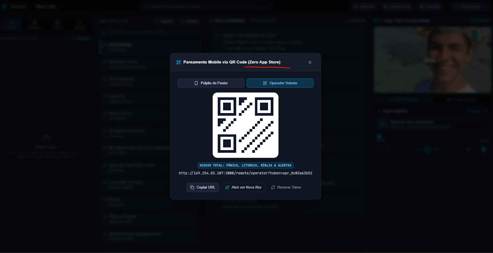

# BUG-019 — Configurações do Servidor Remoto (Ligar/Desligar, Startup, Seleção de IP LAN / `0.0.0.0`) e QR Code Real

- **Status:** Closed

- **Severidade:** Alto | **Tipo:** Bug de Rede / QR Code / Configuração | **Fase:** 5
- **Problema:** O painel de controle remoto seleciona automaticamente um IP link-local inacessível (`169.254.83.107`), gera um QR Code sintético ilegível e não oferece controles de configuração essenciais: ligar/desligar o servidor remoto manualmente, definir se ele inicia junto com o aplicativo no startup (ligado por padrão) e escolher o endereço IP entre as interfaces de rede disponíveis do computador ou `0.0.0.0`.
- **Arquivos envolvidos:**
  - [remote-auth.ts](../../new-holyrics/slices/remote/daemon/remote-auth.ts#L25-L94)
  - [remote-router.ts](../../new-holyrics/slices/remote/daemon/routes/remote-router.ts#L34-L88)
  - [RemotePairingModal.tsx](../../new-holyrics/slices/remote/ui/components/RemotePairingModal.tsx#L26-L168)
- **Causa-raiz:**
  1. `detectLocalLanIp()` retorna a primeira interface não-interna sem ignorar faixas APIPA (`169.254.x.x`), exibindo `169.254.83.107` no print abaixo.
  2. `buildDeterministicMatrix()` gera um padrão pseudoaleatório por hash que não segue o padrão ISO/IEC 18004, logo não é legível por câmeras de celular.
  3. Não existe API nem UI de configuração para habilitar/desabilitar o serviço remoto, definir comportamento no startup ou escolher a interface de rede (`0.0.0.0` ou IP específico).
- **Solução planejada:**
  1. Implementar enumeração de todas as interfaces IPv4 em `remote-auth.ts` (priorizando `192.168.*` / `10.*` / `172.16-31.*` sobre `169.254.*`) + opção `0.0.0.0`.
  2. Persistir configurações remotas (`enabled`, `autoStart`, `selectedHost`) com endpoints `GET/PUT /api/remote/config`, respeitando `enabled` em `authorizeCommand` e `/api/remote/*`.
  3. Substituir `buildDeterministicMatrix` por biblioteca/gerador real de QR Code SVG.
- **Mídia ([07-remote-control-pairing-modal.png](../media/07-remote-control-pairing-modal.png)):**

