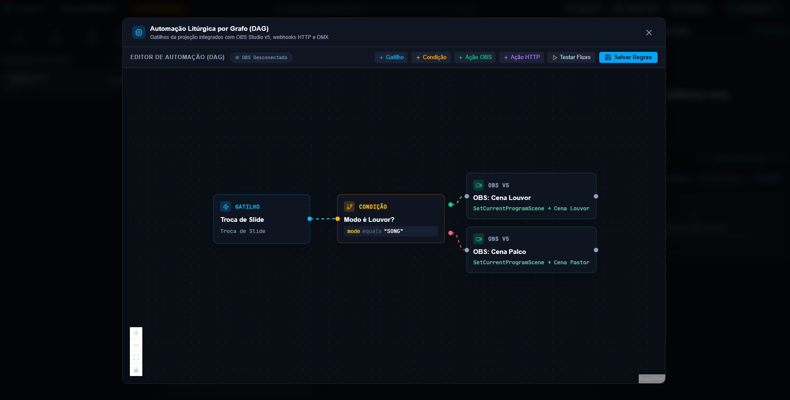

# BUG-021 — Editor de Automações sem edição de nós, menu de botão direito, separação de regras e histórico

- **Status:** Closed

- **Severidade:** Alto | **Tipo:** Feature Incompleta / Interatividade | **Fase:** 6
- **Problema:** O editor visual de automações não é interativo: não permite editar as propriedades dos nós nem clicar com o botão direito para deletar, duplicar ou configurar ações. Além disso, falta feedback visual ao testar fluxos, não há histórico de execução e não está claro para o usuário como múltiplas automações são separadas e organizadas.
- **Arquivos envolvidos:**
  - [CustomNodes.tsx](../../new-holyrics/slices/automation/ui/components/CustomNodes.tsx#L31-L203)
  - [AutomationCanvas.tsx](../../new-holyrics/slices/automation/ui/components/AutomationCanvas.tsx#L49-L333)
  - [AutomationModal.tsx](../../new-holyrics/slices/automation/ui/components/AutomationModal.tsx#L30-L140)
  - [dag-runner.ts](../../new-holyrics/slices/automation/daemon/dag-runner.ts#L64-L156)
- **Causa-raiz:**
  1. Os nós em `CustomNodes.tsx` apenas exibem texto estático; `AutomationCanvas.tsx` não possui `onNodeClick`, `onNodeContextMenu`, `onEdgeContextMenu` nem painel de edição de propriedades do nó selecionado.
  2. Toda a automação reside em um único grafo sem lista/abas para separar regras diferentes (ex.: `"Troca automática OBS"` vs `"Pânico / Luzes"`).
  3. `onTestTrigger` em `AutomationModal.tsx#L87-L93` faz `fetch('/api/automation/test-trigger')` sem retornar nem mostrar feedback visual na UI, e o `DagRunner` não mantém um buffer de histórico de execuções consultável.
- **Solução planejada:**
  1. Adicionar **Menu de Contexto (botão direito)** sobre nós e conexões com ações: `Editar Propriedades`, `Duplicar Nó` e `Excluir`.
  2. Adicionar **Painel Inspector Lateral** ao clicar em um nó para editar nome, tipo de gatilho, condição (`campo`, `operador`, `valor`), cena/ação OBS, URL/método HTTP e tempo de delay.
  3. Estruturar suporte a **múltiplas regras/fluxos independentes** com barra lateral de seleção (criar, renomear, ativar/desativar, excluir fluxo).
  4. Registrar **Histórico de Execuções** no `DagRunner` (com timestamp, gatilho, nós executados, sucesso/erro/ignorado) e exibi-lo em aba dedicada no modal junto com feedback visual de `"Testar Fluxo"`.
- **Mídia ([04-editor-automacoes-overview.png](../media/04-editor-automacoes-overview.png)):**

